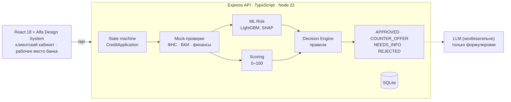

# Опора — умный кредитный кабинет для бизнеса

Модуль финансирования цифрового банка для малого бизнеса: предприниматель описывает задачу своими словами, а
«Опора» подбирает кредит, заранее показывает ставку и платёж, проводит заявку через пять понятных этапов, объясняет
решение и подсказывает, как его улучшить. Решение кейса «Альфа-Будущее Хакатон 2026».

**Публичное демо: [alfa.business-opora.ru](https://alfa.business-opora.ru)** — без регистрации, на синтетических данных.

> Компании, продукты, ставки, ответы ФНС/БКИ, ML-модель, скоринг и решения вымышлены. Реальные системы, API и данные
> Альфа-Банка не используются; договор, выдача и платежи моделируются.

## Какую проблему решает

Предприниматель думает задачей («открыть вторую кофейню»), а банк — продуктами и анкетами. Условия становятся понятны
только после заявки, статус непрозрачен, а ответ сводится к «да» или «нет» без объяснения и без следующего шага.
«Опора» ведёт от задачи к деньгам и объясняет каждый шаг — клиенту и банку на одной заявке.
Как мы проверяли гипотезы — [docs/research.md](docs/research.md).

## Проверить за 5 минут

На https://alfa.business-opora.ru (или локально, см. [запуск](#запуск-в-docker)):

1. **«Я клиент Альфа-Банка»** → **ООО «Демо Техсервис»** → «Войти» → **«Получить финансирование»**.
2. **Потребность** заполнена по сценарию (оборудование, 15 000 000 ₽ на 36 мес.) → «Подобрать финансирование».
3. **Подбор**: у рекомендованного продукта ставка разложена на ключевую ставку и маржу, виден платёж и предупреждение
   о нагрузке → «Выбрать продукт».
4. **Анкета**: «Заполнить демо-данными» → «Отправить на рассмотрение».
5. **Рассмотрение** → **Решение**: встречное предложение 9 900 000 ₽ на 60 мес. с причинами и блоком
   **«Как улучшить заявку»** (расчётные сценарии) → «Принять» → «Подписать» → «Получить финансирование» →
   «Смоделировать очередной платёж».
6. **«Рабочее место банка»** (ссылка в шапке) → та же заявка изнутри: проверки, ML-риск с факторами, скоринг, решение,
   история переходов.

Другие исходы — компании A, C, D и вход не клиента по ИНН (E, F), см. [демо-сценарии](#демо-сценарии).

## Что реализовано

- Полный путь одной заявки: потребность → подбор → анкета → рассмотрение → решение → принятие, подписание, выдача и
  платежи (симуляция).
- Клиент банка (данные подставляются) и не клиент (поиск по ИНН, подтверждение сведений, свои показатели).
- Прозрачная цена, четыре исхода решения, «Как улучшить заявку», сопровождение после выдачи.
- Рабочее место банка над теми же заявками.
- Детерминированный скоринг и правила решения; ML-модель риска (LightGBM, SHAP) как один из входов; необязательный
  локальный LLM только для формулировок.
- Интерфейс на открытой дизайн-системе Альфа-Банка; desktop и телефон 360–430 px.
- Express API с OpenAPI, SQLite, Docker Compose, тесты (unit, API, контракт, паритет ML, E2E, Docker smoke).

## Продуктовая идея: пять этапов одной заявки

| Этап | Что видит клиент |
|---|---|
| 1. **Потребность** | Задача своими словами → цель, сумма, срок; ориентировочный платёж ещё до заявки |
| 2. **Подбор** | Продукты под задачу: почему подходит или нет, ставка, платёж, переплата, риски, альтернативы |
| 3. **Анкета** | Только поля, которые используются в оценке; у каждого — «Зачем банк спрашивает это?»; готовность без загадочных процентов |
| 4. **Рассмотрение** | Этапы проверки простыми словами |
| 5. **Решение** | Что произошло, почему и что дальше; принятие, подписание, выдача и сопровождение |

Подробнее — [продуктовая концепция](docs/product-concept.md), [пять шагов](docs/five-step-client-journey.md).

## Одна заявка — две стороны

Клиентский кабинет (`#/`, `#/credit/…`) и рабочее место банка (`#/bank/…`) работают с одной `CreditApplication` и
одной state machine. Клиент видит понятные статусы и объяснения, банк — внутренний путь заявки
(APPLICATION RECEIVED → … → RESULT), mock-проверки, ML-риск с факторами, скоринг, решение и журнал событий.
Подробнее — [клиент и не клиент](docs/client-vs-nonclient.md), [state machine](docs/application-state-machine.md).

## Основные особенности

| | |
|---|---|
| **Подбор под потребность** | Свободный текст разбирается правилами (LLM — по желанию); подбор учитывает цель, сумму, срок, возраст бизнеса и платёжеспособность |
| **Прозрачная ставка** | Ставка = ключевая + маржа продукта (+ надбавка за риск), например **19,5% годовых** = 16% + 3,5%; платёж и переплата до подачи |
| **Четыре исхода** | **APPROVED** · **COUNTER_OFFER** (другие сумма/срок) · **NEEDS_INFO** (что именно добавить) · **REJECTED** (причины и шаг) |
| **«Как улучшить заявку»** | Рекомендации и расчётные сценарии суммы и срока по той же модели оценки, с нагрузкой на прибыль; без обещаний |
| **Банковская сторона** | KPI, фильтры, поиск, карточка заявки: проверки, ML-риск с SHAP, скоринг по факторам, решение, история |
| **После выдачи** | Остаток, график, платежи, «Следующие возможности» с условиями доступности (симуляция) |

## Архитектура



**Scoring ≠ ML Risk ≠ Credit Decision ≠ LLM Explanation.** Решение принимают прозрачные правила. ML-оценка — один из
входов: при высокой вероятности риска условия осторожнее, но стоп-факторы она не отменяет и одобрения сама не даёт.
LLM получает уже готовый результат; без него работают шаблоны.

Подробнее — [архитектура](docs/architecture.md), [модель данных](docs/data-model.md),
[скоринг и решение](docs/scoring-and-decision.md), [ML-модель риска](docs/ml-risk-model.md),
[LLM](docs/llm-architecture.md), [интеграции](docs/integrations.md), [дизайн-система](docs/design-system.md).

## Запуск в Docker

```bash
docker compose up --build
```

Frontend — http://localhost:3000, API — http://localhost:3002/api/health. Ключи и `.env` не нужны, ML-модель входит в
образ, LLM выключен. Порты заняты: `FRONTEND_PORT=3100 API_PORT=3102 docker compose up --build`. Заявки хранятся в
volume `credit-data` (`docker compose down -v` — сброс).

Необязательный LLM-ассистент (веса не скачиваются автоматически):

```bash
docker compose --profile ai up -d ollama
docker compose exec ollama ollama pull qwen2.5:7b-instruct    # ≈4.7 ГБ, один раз
AI_ENABLED=true docker compose up -d api
```

Запуск без Docker, переменные окружения и деплой публичного демо — [docs/deployment.md](docs/deployment.md).

## Демо-сценарии

Шесть синтетических компаний воспроизводят все исходы. ИНН синтетические (контрольная сумма верна, регион `00`).

| | Компания (ИНН) | Вход | Потребность | Результат |
|---|---|---|---|---|
| A | ООО «Демо Хлебозавод» (0001000010) | клиент | 3 000 000 ₽ / 12 мес., оборотные | **APPROVED** 19,5% → выдача и платежи |
| B | ООО «Демо Техсервис» (0002000020) | клиент | 15 000 000 ₽ / 36 мес., оборудование | **COUNTER_OFFER** 9 900 000 ₽ / 60 мес., «Как улучшить заявку» |
| C | ООО «Демо Агро» (0003000030) | клиент без отчётности | 2 000 000 ₽ / 12 мес. | **NEEDS_INFO** → после показателей **APPROVED** |
| D | ООО «Демо Ремстрой» (0004000040) | клиент | 5 000 000 ₽ / 24 мес. | **REJECTED**: просрочка 97 дней |
| E | ООО «Демо Кофейня» (0005000050) | не клиент, по ИНН | вторая точка, 4 000 000 ₽ / 36 мес. | **APPROVED** 17,5% |
| F | ООО «Демо Старт» (0006000060) | не клиент, бизнесу 10 мес. | 800 000 ₽ / 12 мес. | **COUNTER_OFFER** 600 000 ₽ / 20 мес. |

Пошагово — [docs/demo-scenarios.md](docs/demo-scenarios.md).

## API и документация

- [openapi.yaml](openapi.yaml) — OpenAPI 3.0.3; тест сверяет все маршруты Express со спецификацией и живые ответы
  полного сценария со схемами. [DATA-API.yaml](DATA-API.yaml) — публичные read-only проверки.
- [Postman-коллекция](postman/credit-conveyor.postman_collection.json) — сценарии A–F.
- Основные ресурсы: `/api/health`, `/api/applications` (создание, изменение, документы, `submit`, `process`, `accept`,
  `sign`, `issue`, `payments`), `/api/applications/:id/matches|risk|scoring|decision|improvements|explanation|events`,
  `/api/bank/applications`. Ошибки — `{ error, code, details? }`, у каждого ответа `X-Request-Id`, команды POST
  принимают `Idempotency-Key`.

| Документ | О чём |
|---|---|
| [product-concept](docs/product-concept.md), [research](docs/research.md) | Идея, проблема, проверка гипотез |
| [five-step-client-journey](docs/five-step-client-journey.md), [client-vs-nonclient](docs/client-vs-nonclient.md), [post-credit-support](docs/post-credit-support.md) | Клиентский путь |
| [architecture](docs/architecture.md), [application-state-machine](docs/application-state-machine.md), [data-model](docs/data-model.md) | Устройство системы |
| [scoring-and-decision](docs/scoring-and-decision.md), [ml-risk-model](docs/ml-risk-model.md), [llm-architecture](docs/llm-architecture.md) | Оценка и объяснение |
| [integrations](docs/integrations.md), [deployment](docs/deployment.md) | Mock-провайдеры, запуск, деплой |
| [design-system](docs/design-system.md), [demo-scenarios](docs/demo-scenarios.md), [test-scenarios](docs/test-scenarios.md), [assumptions](docs/assumptions.md) | Интерфейс, сценарии, тесты, допущения |

## Тесты

```bash
npm test                                   # frontend + API: unit, API, контракт OpenAPI, паритет ML с Python, LLM-фолбэк
npm run build
npm run test:production --prefix miniapp   # production-сервер frontend
node --test ops/deploy.test.cjs            # конфигурация деплоя
npm run smoke:docker                       # docker compose с нуля: healthcheck, сценарии A–F через nginx, перезапуск
# E2E в браузере (нужны запущенные API и frontend):
npx --prefix miniapp playwright install chromium webkit
OPORA_UI_ENGINE=chromium,webkit npm run test:e2e
```

E2E проходит сценарии A–F через интерфейс на 1280 и 390 px: нет горизонтальной прокрутки и ошибок консоли, цели нажатия
на телефоне не меньше 40 px. Состав — [docs/test-scenarios.md](docs/test-scenarios.md).

## Исследование и продуктовые решения

Команда изучила материалы кейса, разобрала кредитный процесс и клиентский путь и провела качественную валидацию
продуктовых гипотез в интервью с владельцем действующего бизнеса. Связь «проблема → решение», принятые решения и
границы исследования — [docs/research.md](docs/research.md).

## Ограничения и допущения

- Всё синтетическое: данные, продукты, ставки, скоринг, правила, ML-модель. Это демонстрация процесса, не банковская система.
- ФНС, БКИ, финансовые данные и «данные банка» о клиенте — локальные mock-провайдеры без сети.
- Роли без авторизации: «вход клиента» — выбор демо-компании, рабочее место банка открыто всем.
- Документы не загружаются на сервер: передаются тип, имя, размер и число символов, извлечённых в браузере.
- Подписание, выдача и платежи моделируются; денег и проводок нет.
- ML-модель обучена на сгенерированных данных: метрики показывают качество метода, а не реальный кредитный риск.
- LLM необязателен; без него объяснения формируются шаблонами.

Полный список — [docs/assumptions.md](docs/assumptions.md).

## Сторонние компоненты

Лицензии зависимостей, смоделированные и необязательные интеграции — [THIRD_PARTY_NOTICES.md](THIRD_PARTY_NOTICES.md).
