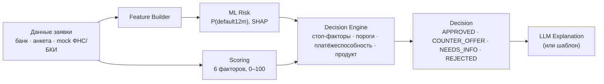
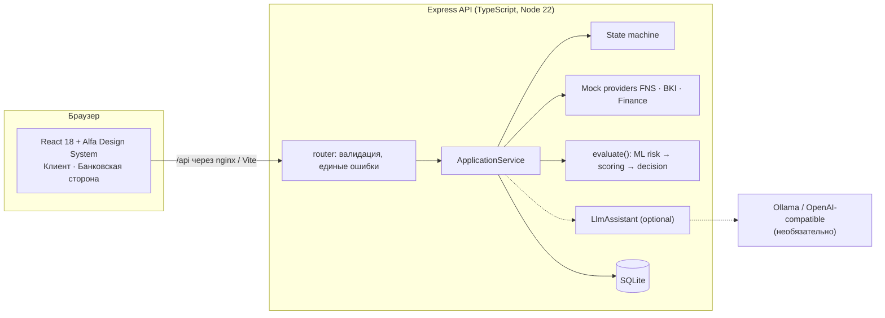

# Опора

**Умный кредитный кабинет для бизнеса** — модуль финансирования цифрового банка для бизнеса. Решение кейса
«Альфа-Будущее Хакатон 2026».

> **Демо на синтетических данных.** Компании, банковские профили, кредитные продукты, ставки, ответы ФНС/БКИ,
> ML-модель риска, скоринг и решения вымышлены. Реальные системы, API и данные Альфа-Банка не используются,
> авторизации нет, договор, выдача и платежи моделируются. Названия продуктов и формула ставки — иллюстрация,
> а не продукты и политика какого-либо банка.

## Что это

Предприниматель описывает задачу своими словами — «Опора» подбирает финансирование, собирает только нужные данные,
рассматривает заявку и объясняет решение, а после выдачи сопровождает кредит. Одна заявка (`CreditApplication`)
проходит пять видимых шагов:

| Шаг | Что происходит |
|---|---|
| 1. **Потребность** | Свободный текст («Хочу открыть вторую кофейню… около 4 млн») → цель, сумма, срок. Разбор по правилам, LLM — по желанию |
| 2. **Подбор** | 6 продуктов: почему подходит, какие данные учтены, ограничения, ставка (ключевая + маржа + риск), платёж, переплата, риски, альтернативы |
| 3. **Анкета** | Компания · Финансы · Обязательства · Кредитная история · Параметры · Документы; у каждого поля «Зачем банк спрашивает это?» |
| 4. **Рассмотрение** | Проверки (mock ФНС/БКИ/финансы) → ML-оценка риска → скоринг → решение по правилам |
| 5. **Решение** | Что произошло, почему, что дальше; «Как улучшить заявку» с расчётными сценариями; принятие → подписание → выдача (симуляция) |

Клиент банка входит в демо-кабинет и получает предзаполненные (синтетические) данные; не клиент находит компанию по ИНН,
подтверждает сведения и вводит показатели. Банковская сторона видит ту же заявку изнутри.

Подробнее: [продуктовая концепция](docs/product-concept.md), [пять шагов](docs/five-step-client-journey.md),
[клиент и не клиент](docs/client-vs-nonclient.md), [сопровождение после выдачи](docs/post-credit-support.md).

## Три независимых контура

| Контур | Что делает | Что **не** делает |
|---|---|---|
| **Core Credit Engine** — state machine, mock-проверки, `ScoringEngine`, `CreditDecisionEngine` | Детерминированно оценивает заявку и **принимает решение** по прозрачным правилам | — |
| **ML Risk Model** — LightGBM на синтетических данных, `default12m` | Оценивает вероятность проблемного обслуживания и объясняет её факторами SHAP | Не принимает решение: только один из входов правил |
| **LLM Assistant** — локальная open-weight модель, по умолчанию выключен | Разбирает текст потребности, формулирует объяснения решения и сценариев | Не решает, не оценивает, не считает деньги, не меняет решение |

**Scoring ≠ ML Risk ≠ Credit Decision ≠ LLM Explanation.**



ML влияет на решение только так: при вероятности ≥ 20% заявка считается рискованнее (надбавка к ставке, осторожные
условия). Отказ по стоп-факторам ML не отменяет, одобрение без правил не даёт. LLM получает уже готовый результат.

## Архитектура



Подробнее: [архитектура](docs/architecture.md), [state machine](docs/application-state-machine.md),
[модель данных](docs/data-model.md), [скоринг и решение](docs/scoring-and-decision.md),
[ML-модель риска](docs/ml-risk-model.md), [LLM-архитектура](docs/llm-architecture.md),
[интеграции](docs/integrations.md), [дизайн-система](docs/design-system.md).

## Стек

| Слой | Технологии |
|---|---|
| Frontend | React 18, TypeScript, Vite 5, `@alfalab/core-components` (Button, Input, Select, Textarea, RadioGroup, Tag, Steps, Tabs, Table, SegmentedControl, Status, Plate, Amount, Typography, Tooltip, Progress) и токены `core-components-vars`, иконки `@alfalab/icons-glyph`; из своего — только логотип «Опоры», чтение PDF/DOCX/сканов в браузере (pdf.js, mammoth, tesseract.js) |
| API | Node.js 22, Express 4, TypeScript, встроенный `node:sqlite` |
| ML (офлайн) | Python, numpy, pandas, scikit-learn, LightGBM; модель экспортируется в JSON и исполняется в TypeScript с точным TreeSHAP |
| LLM (опционально) | Ollama + `qwen2.5:7b-instruct` (Apache-2.0) через OpenAI-совместимый API |
| Тесты | `node:test` + tsx (unit, API, контракт OpenAPI, паритет ML с Python), Playwright (Chromium и WebKit, 1280 и 390 px) |
| Запуск | Docker Compose: API + nginx; профиль `ai` — Ollama |

## Запуск в Docker

```bash
docker compose up --build
```

- Frontend: http://localhost:3000 · API: http://localhost:3002/api/health
- Ключи и `.env` не нужны. ML-модель входит в образ API. LLM выключен.
- Заявки хранятся в volume `credit-data`; `docker compose down -v` удаляет их.
- Порты заняты? `FRONTEND_PORT=3100 API_PORT=3102 docker compose up --build`.

Проверка всего стека (сборка, healthcheck, 6 сценариев через nginx, ML, выдача и идемпотентный платёж, перезапуск;
отдельный compose-проект на портах 3100/3102):

```bash
npm run smoke:docker
```

### Необязательный LLM-ассистент

Веса модели не скачиваются автоматически. Чтобы включить ассистента:

```bash
docker compose --profile ai up -d ollama
docker compose exec ollama ollama pull qwen2.5:7b-instruct    # ≈4.7 ГБ, один раз
AI_ENABLED=true docker compose up -d api
```

Ollama на хосте вместо контейнера: `LLM_BASE_URL=http://host.docker.internal:11434/v1`. Весь сценарий работает и с
`AI_ENABLED=false` — объяснения строятся детерминированными шаблонами ([docs/llm-architecture.md](docs/llm-architecture.md)).

## Локальный запуск

```bash
npm ci --prefix miniapp
npm ci --prefix miniapp/api-server
npm run api:dev      # терминал 1: API на http://localhost:3002
npm run dev          # терминал 2: frontend на http://localhost:3000
```

Production-сборка без Docker: `npm run build`, затем `npm run api:server` и `npm start --prefix miniapp`
(`API_URL` — адрес API для frontend-сервера, по умолчанию `http://127.0.0.1:3002`).

### Production-деплой (PM2)

Экземпляр работает рядом с другим проектом на том же сервере и не пересекается с ним: свои каталоги, процессы
PM2 и порты. Все идентификаторы — в [ops/production.cjs](ops/production.cjs).

| | Этот экземпляр | Не трогать (другой проект) |
|---|---|---|
| Код | `/opt/alfa-opora` | `/opt/app` |
| Временные сборки и lock | `/opt/alfa-opora-deploy` (`release-*`, `deploy.lock`) | `/opt/opora-deploy` |
| PM2 | `alfa-opora-frontend`, `alfa-opora-api` | `opora-frontend`, `opora-api` |
| Порты | frontend `127.0.0.1:3100`, API `127.0.0.1:3102` | 3000, 3002 |
| Домен | `alfa.business-opora.ru` (HTTPS-ingress → `127.0.0.1:3100`) | `business-opora.ru` |

Первый запуск (один раз; `deploy.cjs` требует уже работающий `alfa-opora-api`, чтобы перенести его настройки):

```bash
git clone <repo> /opt/alfa-opora && mkdir -p /opt/alfa-opora-deploy && cd /opt/alfa-opora
npm ci --prefix miniapp && npm ci --prefix miniapp/api-server && npm run build
APP_ORIGIN=https://alfa.business-opora.ru node miniapp/scripts/restart-api.cjs   # alfa-opora-api на 127.0.0.1:3102
pm2 start ecosystem.config.cjs && pm2 save                                       # alfa-opora-frontend на 127.0.0.1:3100
node miniapp/scripts/check-production.cjs
```

Обновление до коммита из `main`:

```bash
flock -n /opt/alfa-opora-deploy/deploy.lock node /opt/alfa-opora/ops/deploy.cjs /opt/alfa-opora <sha>
```

`deploy.cjs` принимает только `/opt/alfa-opora`, собирает и тестирует коммит во временной папке, переключает
артефакты, перезапускает и проверяет (`/api/health` на 3102, `check-production` на 3100, стабильность в PM2) только
`alfa-opora-*`, при ошибке откатывается. Процессы и порты другого проекта не перечисляются, не перезапускаются и не
удаляются (`ops/deploy.test.cjs`, `miniapp/scripts/restart-api.test.cjs`).

### Переобучение ML-модели (необязательно)

```bash
cd ml && python3 -m venv .venv && . .venv/bin/activate && pip install -r requirements.txt
python generate_dataset.py && python train.py && python evaluate.py && python inference.py --check
```

## Переменные окружения

Все необязательны; шаблон — [.env.example](.env.example).

| Переменная | Назначение | По умолчанию |
|---|---|---|
| `PORT`, `APP_ORIGIN` | Порт API, разрешённые origin для CORS | `3002`, `http://localhost:3000` |
| `API_HOST` | Адрес, на котором слушает API | `0.0.0.0`; в PM2-деплое `127.0.0.1` |
| `CREDIT_DB_PATH` | Файл SQLite | `miniapp/api-server/data/credit.sqlite`; в Docker `/data/credit/credit.sqlite` |
| `CREDIT_KEY_RATE` | Демо-ключевая ставка, % | `16` |
| `RISK_MODEL_ENABLED` | ML-модель риска (`false` — решения только по скорингу и правилам) | `true` |
| `AI_ENABLED` | LLM-ассистент | `false` |
| `LLM_BASE_URL`, `LLM_MODEL`, `LLM_API_KEY`, `LLM_TIMEOUT_MS` | OpenAI-совместимый endpoint | `http://127.0.0.1:11434/v1`, `qwen2.5:7b-instruct`, —, `20000` |
| `API_RATE_LIMIT` | Запросов в минуту на клиента | `300` |
| `TRUST_PROXY` | Доверенные прокси для `X-Forwarded-For` | `loopback`; в Docker `loopback,uniquelocal` |
| `LOG_REQUESTS` | JSON-логи запросов (без ИНН в пути) | в production включены |
| `DADATA_API_KEY`, `FNS_DATA_DIR` | Необязательный поиск произвольной компании по ИНН | — |
| `FRONTEND_PORT`, `API_PORT`, `OLLAMA_PORT` | Порты на хосте для Docker Compose | `3000`, `3002`, `11434` |

## Демо-сценарии

Две отдельные оболочки над одной заявкой: **клиентский кабинет** (`#/`, `#/credit/…`) и **рабочее место банка** (`#/bank/…`, ссылка «Рабочее место банка» в шапке). Без авторизации.

| | Компания (ИНН) | Вход | Потребность | Результат |
|---|---|---|---|---|
| A | ООО «Демо Хлебозавод» (0001000010) | клиент | 3 000 000 ₽ / 12 мес., оборотные | **APPROVED** 19,5%; скоринг 95, ML 0,5% |
| B | ООО «Демо Техсервис» (0002000020) | клиент | 15 000 000 ₽ / 36 мес., оборудование | **COUNTER_OFFER** 9 900 000 ₽ / 60 мес. |
| C | ООО «Демо Агро» (0003000030) | клиент без отчётности | 2 000 000 ₽ / 12 мес. | **NEEDS_INFO** → после показателей **APPROVED** |
| D | ООО «Демо Ремстрой» (0004000040) | клиент | 5 000 000 ₽ / 24 мес. | **REJECTED**: просрочка 97 дней; ML 99,5% |
| E | ООО «Демо Кофейня» (0005000050) | не клиент, по ИНН | вторая точка, 4 000 000 ₽ / 36 мес. | **APPROVED** 17,5% |
| F | ООО «Демо Старт» (0006000060) | не клиент, бизнесу 10 мес. | 800 000 ₽ / 12 мес. | **COUNTER_OFFER** 600 000 ₽ / 20 мес., «Развитие молодого бизнеса» |

ИНН синтетические: контрольная сумма верна, код региона `00` не присвоен. Пошагово — [docs/demo-scenarios.md](docs/demo-scenarios.md).

### Быстрая проверка

1. http://localhost:3000 → **«Я клиент Альфа-Банка»** → **ООО «Демо Хлебозавод»** → **«Получить финансирование»**.
2. **Потребность**: всё заполнено по сценарию → «Подобрать финансирование».
3. **Подбор**: «Оборотный кредит» отмечен «Рекомендуем» → «Выбрать продукт».
4. **Анкета**: «Заполнить демо-данными» → «Отправить на рассмотрение».
5. **Рассмотрение** → **Решение**: «Заявка одобрена» с причинами и объяснением → «Принять» → «Подписать (симуляция)» →
   «Получить финансирование (симуляция)» → «Смоделировать очередной платёж», «Следующие возможности».
6. «Рабочее место банка» → KPI, фильтры, таблица → заявка: путь APPLICATION RECEIVED → … → RESULT, mock-проверки, ML-риск с факторами,
   скоринг, решение, история переходов.
7. Повторите для B (блок «Как улучшить заявку»), D и не клиента E: «Я пока не клиент» → ИНН `0005000050`.

## API

- [openapi.yaml](openapi.yaml) — OpenAPI 3.0.3; тест сверяет все маршруты Express со спецификацией и живые ответы полного
  сценария со схемами. [DATA-API.yaml](DATA-API.yaml) — публичные проверки.
  [Postman](postman/credit-conveyor.postman_collection.json) — сценарии A–F.

| Метод | Путь | Назначение |
|---|---|---|
| GET | `/api/health` | Состояние, число продуктов и компаний, ключевая ставка, версия ML, статус AI |
| GET | `/api/credit/products` | Каталог (и подбор по параметрам) |
| GET | `/api/demo/companies`, `/api/companies/:inn` | Демо-компании; компания по ИНН |
| POST · GET | `/api/applications` | Создать заявку · список (`?inn=`) |
| GET · PATCH | `/api/applications/:id` | Заявка · изменение (`version` — оптимистичная блокировка) |
| GET | `/api/applications/:id/matches` | Шаг «Подбор» |
| POST | `/api/applications/:id/documents` | Метаданные документа (файл остаётся в браузере) |
| POST | `/api/applications/:id/submit`, `/process` | Отправка; рассмотрение (атомарно, идемпотентно) |
| GET | `/api/applications/:id/risk`, `/scoring`, `/decision`, `/events` | ML-оценка, скоринг, решение, история |
| GET | `/api/applications/:id/improvements` | «Как улучшить заявку» |
| GET | `/api/applications/:id/explanation?kind=decision\|improvements` | Объяснение (LLM или шаблон) |
| POST | `/api/applications/:id/accept`, `/sign`, `/issue`, `/payments` | Принятие; подписание, выдача, платёж — симуляция |
| POST | `/api/assistant/parse-need` | Разбор текста потребности |
| GET | `/api/bank/applications`, `/api/bank/applications/:id` | Банковская сторона |

Ошибки — `{ error, code, details? }`. Каждый ответ содержит `X-Request-Id`; команды POST принимают `Idempotency-Key`.

## Тесты

```bash
npm test                 # frontend + API: unit, API, контракт OpenAPI, паритет ML, LLM-фолбэк
npm run build
npm run test:production --prefix miniapp
node --test ops/deploy.test.cjs
# E2E (нужны запущенные API и frontend):
npx --prefix miniapp playwright install chromium webkit
OPORA_UI_ENGINE=chromium,webkit npm run test:e2e
npm run smoke:docker
```

Состав — [docs/test-scenarios.md](docs/test-scenarios.md).

## Ограничения и допущения

- Всё синтетическое: данные, продукты, ставки, скоринг, правила, ML-модель. Это демонстрация процесса, не банковская система.
- ФНС, БКИ, финансовые данные и «данные банка» о клиенте — локальные mock без сети.
- Роли без авторизации; «вход клиента» — выбор демо-компании.
- Документы не загружаются на сервер (тип, имя, размер, число символов, извлечённых в браузере; OCR — tesseract.js локально).
- Подписание, выдача и платежи моделируются; денег и проводок нет.
- ML-модель обучена на сгенерированных данных: её метрики показывают качество метода, а не реальный кредитный риск.
- LLM необязателен; без него объяснения формируются шаблонами.

Полный список — [docs/assumptions.md](docs/assumptions.md).

## Лицензии

Сторонние компоненты — [THIRD_PARTY_NOTICES.md](THIRD_PARTY_NOTICES.md). История предыдущего продукта проекта
сохранена в [docs/archive/opora-funding](docs/archive/opora-funding/README.md).
