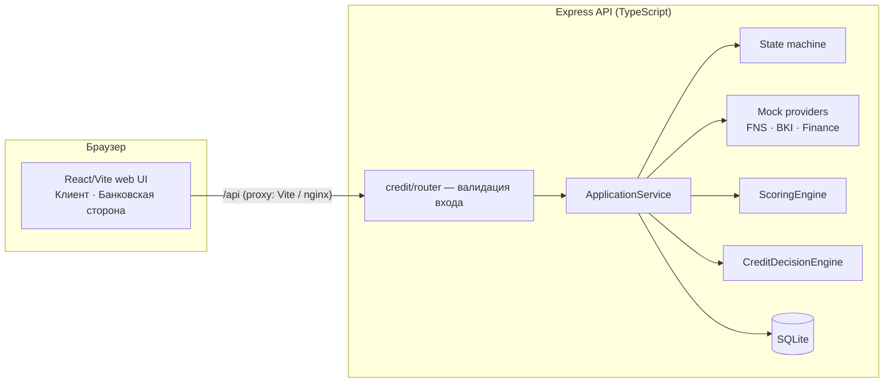

# Умный кредитный кабинет предпринимателя

MVP цифрового кредитного конвейера для малого и микробизнеса — решение кейса «Альфа-Будущее Хакатон 2026».

> **Все данные синтетические.** Компании, кредитные продукты, ставки, проверки ФНС/БКИ, скоринг и кредитные решения
> вымышлены и служат только для демонстрации логики. Это не продукты и не модели какого-либо банка, реальные банковские
> системы и платные API не используются, договор подписывается в режиме симуляции, деньги не перечисляются.

## Проблема

Предприниматель, которому нужны деньги на бизнес, проходит разрозненный путь: сам выбирает продукт среди условий, которые
плохо понимает, заполняет анкету, отдельно собирает документы, ждёт и получает «одобрено/отказ» без объяснения. Банку
тоже неудобно: заявки приходят неполными, проверки и оценка живут в разных системах, а повторная подача после запроса
документов начинается почти с нуля.

## Решение

Один сквозной процесс в web-кабинете, где на каждом шаге видно состояние заявки и следующий шаг:

1. **Потребность** — цель, сумма, срок.
2. **Подбор продукта** — каждому продукту объяснено, почему он подходит или нет.
3. **Заявка** — данные, финансовые показатели, документы и индикатор полноты; отправить можно только полную заявку.
4. **Обработка** — проверка данных → сведения из (mock) ФНС, БКИ и финансовых источников → скоринг → кредитное решение.
5. **Результат** — одобрение, встречное предложение, запрос данных или отказ: что произошло, почему и что делать дальше.
6. **Банковская сторона** — тот же процесс изнутри: проверки, факторы скоринга, риск, правила решения, история состояний.

Состояние заявки хранится на сервере (SQLite) и меняется только через явную state machine; каждый переход — событие.

## Архитектура



Подробнее: [docs/architecture.md](docs/architecture.md), [state machine](docs/application-state-machine.md),
[модель данных](docs/data-model.md), [скоринг и решение](docs/scoring-and-decision.md), [интеграции](docs/integrations.md).

## Стек

| Слой | Технологии |
|---|---|
| Frontend | React 18, TypeScript, Vite 5, собственные UI-примитивы, чтение PDF/DOCX/сканов в браузере (pdf.js, mammoth, tesseract.js) |
| API | Node.js 22, Express 4, TypeScript, встроенный `node:sqlite` |
| Хранилище | SQLite (WAL), синтетические данные сидируются при каждом старте |
| Тесты | `node:test` + tsx (unit, API, контракт с OpenAPI), Playwright (E2E в Chromium и WebKit) |
| Запуск | Docker Compose: API + nginx со статикой frontend и proxy `/api` |

ML, LLM, очереди и микросервисы не используются: скоринг и решение — детерминированные правила, которые можно прочитать и проверить.

## Требования

- **Docker:** Docker Engine/Desktop с Docker Compose v2 — ничего больше не нужно.
- **Локально без Docker:** Node.js **22.13+** (нужен встроенный `node:sqlite`) и npm.

## Запуск в Docker

```bash
docker compose up --build
```

- Frontend: http://localhost:3000
- API: http://localhost:3002/api/health

Ключи и `.env` не нужны: демо-данные создаются автоматически, внешние проверки — локальные mock. Заявки сохраняются в
volume `credit-data` и переживают перезапуск; `docker compose down -v` удаляет их. Если порты заняты:
`FRONTEND_PORT=3100 API_PORT=3102 docker compose up --build`.

Автоматическая проверка всего стека (сборка, healthcheck, 4 сценария через nginx, сохранность после перезапуска, остановка;
использует отдельный compose-проект на портах 3100/3102):

```bash
npm run smoke:docker
```

## Локальный запуск

```bash
npm ci --prefix miniapp
npm ci --prefix miniapp/api-server
npm run api:dev      # терминал 1: API на http://localhost:3002, база miniapp/api-server/data/credit.sqlite
npm run dev          # терминал 2: frontend на http://localhost:3000 (проксирует /api на 3002)
```

Production-сборка без Docker: `npm run build`, затем `npm run api:server` и `npm start --prefix miniapp`.

## Переменные окружения

Все необязательны; `.env.example` — шаблон.

| Переменная | Назначение | По умолчанию |
|---|---|---|
| `PORT` | Порт API | `3002` |
| `APP_ORIGIN` | Разрешённые origin для CORS (через запятую) | `http://localhost:3000` |
| `CREDIT_DB_PATH` | Файл SQLite с заявками | `miniapp/api-server/data/credit.sqlite`; в Docker `/data/credit/credit.sqlite` |
| `API_RATE_LIMIT` | Запросов в минуту на клиента | `300` |
| `DADATA_API_KEY` | Необязательный поиск произвольной компании по ИНН. Без ключа неизвестная компания вводится вручную | — |
| `FNS_DATA_DIR` | Необязательный импортированный индекс ФНС (`npm run sync:fns`) | `fns-data/` |
| `FRONTEND_PORT`, `API_PORT` | Порты на хосте для Docker Compose | `3000`, `3002` |

## Демо-данные

Роли переключаются в шапке: **«Клиент» / «Банковская сторона»** — это демо-переключатель без авторизации.

| Сценарий | Компания (ИНН) | Запрос | Результат |
|---|---|---|---|
| A | ООО «Демо Хлебозавод» (0001000010) | 3 000 000 ₽ на 12 мес., оборотные средства | **APPROVED**, оценка 96 |
| B | ООО «Демо Техсервис» (0002000020) | 15 000 000 ₽ на 36 мес., оборудование | **COUNTER_OFFER**: 9 900 000 ₽ на 60 мес. |
| C | ООО «Демо Агро» (0003000030) | 2 000 000 ₽ на 12 мес. | **NEEDS_INFO** → после показателей и отчётности **APPROVED** |
| D | ООО «Демо Ремстрой» (0004000040) | 5 000 000 ₽ на 24 мес. | **REJECTED**: просрочка 97 дней, долги 79% выручки |

ИНН синтетические: проходят проверку контрольной суммы, но используют неприсвоенный код региона `00`. Подробности и
пошаговые сценарии — [docs/demo-scenarios.md](docs/demo-scenarios.md).

## Основной сценарий проверки

1. Откройте http://localhost:3000 → **«Получить финансирование»**.
2. Выберите **ООО «Демо Хлебозавод»** → профиль бизнеса → **«Подобрать продукты»** (потребность заполнена по сценарию).
3. Выберите рекомендованный **«Оборотный кредит»** — создаётся заявка на сервере.
4. В заявке нажмите **«Заполнить демо-данными»** (описание цели и синтетический файл выписки) или загрузите свой файл.
5. **«Отправить заявку»** → таймлайн «Проверяем данные компании → Получаем сведения → Оцениваем заявку → Формируем решение».
6. Результат «Заявка одобрена» с причинами → **«Принять предложение»** → **«Подписать договор (симуляция)»**.
7. Переключитесь на **«Банковская сторона»** → откройте заявку: проверки, скоринг по факторам, решение, история событий.
8. Повторите для компаний B, C, D. Для C после запроса данных укажите выручку 18 000 000, расходы 13 200 000,
   долги 500 000, приложите бухгалтерскую отчётность («Демо-файл») и отправьте заявку повторно.

Ручной и автоматический чек-лист — [docs/test-scenarios.md](docs/test-scenarios.md).

## API

- [openapi.yaml](openapi.yaml) — OpenAPI 3.0.3; тест проверяет, что все маршруты Express описаны в спецификации и наоборот,
  а живые ответы полного сценария соответствуют схемам.
- [postman/credit-conveyor.postman_collection.json](postman/credit-conveyor.postman_collection.json) — коллекция Postman
  со сценариями A–D.
- [DATA-API.yaml](DATA-API.yaml) — 6 воспроизводимых публичных проверок.

| Метод | Путь | Назначение |
|---|---|---|
| GET | `/api/credit/products` | Синтетические продукты; с `inn`/`registrationDate`, `purpose`, `amount`, `term` — подбор с объяснением |
| GET | `/api/demo/companies` | Демо-компании A–D |
| GET | `/api/companies/:inn` | Компания: синтетическая, сохранённая или из необязательного реестрового поиска |
| POST | `/api/applications` | Создать заявку (для неизвестного ИНН — с `company`) |
| GET | `/api/applications` | Список заявок (`?inn=`) |
| GET / PATCH | `/api/applications/:id` | Заявка с полнотой и статусом / изменение данных (`version` — оптимистичная блокировка) |
| POST | `/api/applications/:id/documents` | Метаданные документа (файл остаётся в браузере) |
| POST | `/api/applications/:id/submit` | READY_TO_SUBMIT → SUBMITTED |
| POST | `/api/applications/:id/process` | Проверка → mock-проверки → скоринг → решение (атомарно, идемпотентно) |
| POST | `/api/applications/:id/accept`, `/sign` | Принять предложение; подписание — симуляция |
| GET | `/api/applications/:id/events`, `/scoring`, `/decision` | История, скоринг, решение |
| GET | `/api/bank/applications`, `/api/bank/applications/:id` | Банковская сторона |

Ошибки — единый формат `{ error, code, details? }`: `400 VALIDATION_ERROR`, `404`, `409 INVALID_TRANSITION`/`APPLICATION_LOCKED`/`VERSION_CONFLICT`,
`422 APPLICATION_INCOMPLETE`, `429 RATE_LIMITED`.

## Тесты

```bash
npm test                 # unit + API + контракт OpenAPI
npm run build            # сборка API и frontend
npm run test:production --prefix miniapp   # production-сервер frontend
node --test ops/deploy.test.cjs
# E2E в браузере (нужны запущенные API и frontend, см. «Локальный запуск»):
npx --prefix miniapp playwright install chromium webkit
OPORA_UI_ENGINE=chromium,webkit npm run test:e2e
npm run smoke:docker     # Docker smoke test
```

Состав тестов — [docs/test-scenarios.md](docs/test-scenarios.md).

## Ограничения

- Скоринг, правила решения, продукты, ставки и данные «источников» синтетические; это демонстрация логики, а не банковская модель.
- ФНС, БКИ и финансовые данные — локальные mock-провайдеры без сети ([docs/integrations.md](docs/integrations.md)).
- Роли «Клиент / Банковская сторона» — переключатель без авторизации; клиент видит все заявки демо-стенда.
- Документы не загружаются на сервер: передаются тип, имя, размер и число символов, извлечённых в браузере.
  Содержимое документов не проверяется.
- Подписание договора и выдача средств не выполняются.
- AI/LLM в продукте нет; объяснения формируются детерминированно из факторов скоринга и правил решения.

## Допущения

Полный список — [docs/assumptions.md](docs/assumptions.md): синтетические скоринг, правила решения и продукты;
mock-интеграции ФНС/БКИ; симуляция подписания; отсутствие выдачи денег; синтетические демо-данные; решение не является
реальной банковской скоринговой системой.

## Лицензии

Сторонние компоненты и их лицензии — [THIRD_PARTY_NOTICES.md](THIRD_PARTY_NOTICES.md). История предыдущего продукта
проекта («Опора», подбор мер поддержки) сохранена в [docs/archive/opora-funding](docs/archive/opora-funding/README.md).
