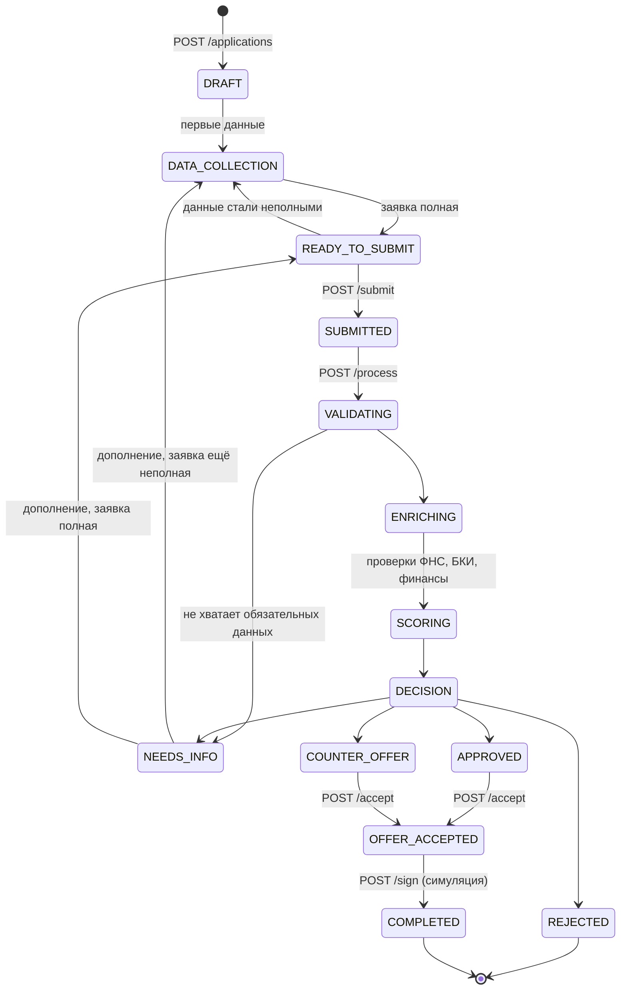

# State machine заявки

Состояние заявки меняется только через `credit/state-machine.ts`. Любой переход, которого нет в таблице, отклоняется
с `409 INVALID_TRANSITION` (в `details` — `from`, `to` и допустимые варианты). Каждый переход записывается как
`ApplicationEvent` с типом `STATE_CHANGED`, `fromState`, `toState` и понятным клиенту сообщением.

## Состояния

| Состояние | Что видит клиент | Кто переводит | Можно менять данные |
|---|---|---|---|
| DRAFT | Черновик | Создание заявки | да |
| DATA_COLLECTION | Заполнение заявки | Изменение данных или документа | да |
| READY_TO_SUBMIT | Готова к отправке | Автоматически, когда все обязательные пункты выполнены | да |
| SUBMITTED | Отправлена | `POST /submit`; номер попытки `attempt` увеличивается | нет |
| VALIDATING | Проверяем данные компании | `POST /process` | нет |
| ENRICHING | Получаем сведения | Обработка | нет |
| SCORING | Оцениваем заявку | Обработка | нет |
| DECISION | Формируем решение | Обработка | нет |
| NEEDS_INFO | Нужны дополнительные данные | Проверка или решение | да |
| APPROVED | Одобрено | Решение | нет |
| COUNTER_OFFER | Встречное предложение | Решение | нет |
| REJECTED | Отказ (финальное) | Решение | нет |
| OFFER_ACCEPTED | Предложение принято | `POST /accept`; условия сохраняются в `acceptedOffer` | нет |
| COMPLETED | Договор подписан (симуляция, финальное) | `POST /sign` | нет |

Промежуточные состояния обработки (`VALIDATING` … `DECISION`) существуют внутри одной транзакции и видны в истории;
клиент наблюдает их как таймлайн.

## Правила

- **Полнота** (`credit/readiness.ts`) пересчитывается после каждого изменения и документа: выбран продукт; цель,
  сумма, срок и срок работы бизнеса соответствуют продукту; описание цели не короче 20 символов; приложены
  обязательные документы продукта. Финансовые показатели и бухгалтерская отчётность желательны, но не обязательны
  для отправки — их отсутствие может привести к NEEDS_INFO, если показателей нет и во внешних источниках.
- **Изменения** разрешены только в `DRAFT`, `DATA_COLLECTION`, `READY_TO_SUBMIT`, `NEEDS_INFO`; иначе
  `409 APPLICATION_LOCKED`. `PATCH` с `version` защищает от одновременной правки (`409 VERSION_CONFLICT`).
- **Отправка** неполной заявки — `422 APPLICATION_INCOMPLETE` со списком недостающего. Повторный `submit` в
  `SUBMITTED` идемпотентен. Из `NEEDS_INFO` отправить нельзя, пока заявка не дополнена (сначала переход в `READY_TO_SUBMIT`).
- **Обработка** идемпотентна: если решение по текущей попытке уже есть, `POST /process` возвращает его с
  `replayed: true` и не создаёт новых проверок, оценок и событий. Сбой на любом этапе откатывает всю обработку.
- **Попытки.** Проверки, скоринг и решения привязаны к `attempt`; после NEEDS_INFO и повторной отправки создаются
  новые записи, прежние остаются в истории (`history.checks` в банковском представлении).

## События

| Тип | Когда |
|---|---|
| CREATED | Создание заявки |
| UPDATED | Изменение данных (в `payload.fields` — изменённые поля) |
| STATE_CHANGED | Любой переход состояния |
| DOCUMENT_ADDED | Добавлен документ |
| CHECK_COMPLETED | Получен ответ mock-провайдера |
| SCORED | Рассчитан скоринг (`score`, `riskLevel`) |
| DECIDED | Сформировано решение (`outcome`, `offer`) |

Номер события `sequence` непрерывен в пределах заявки. История доступна клиенту в упрощённом виде (`timeline`) и
банковской стороне полностью (`GET /api/applications/:id/events`, `GET /api/bank/applications/:id`).

Тесты: `miniapp/api-server/credit/state-machine.test.ts`, переходы через API — `credit/api.test.ts`.
