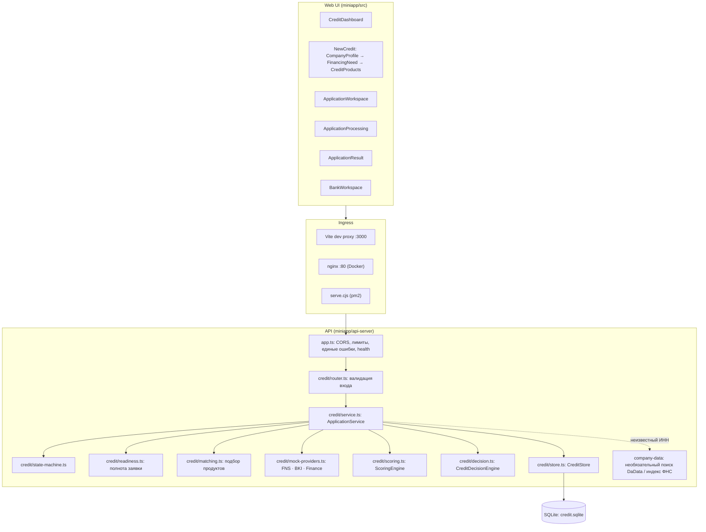
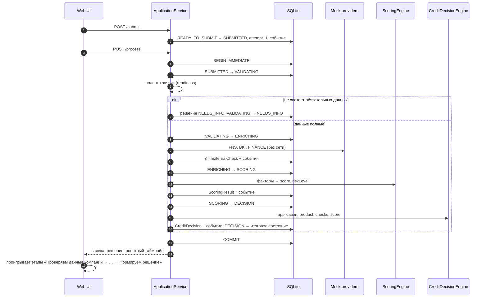
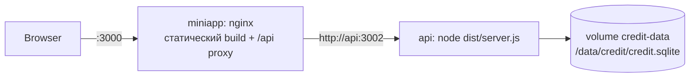

# Архитектура

Монолит из двух процессов: web-клиент (React/Vite) и API (Express/TypeScript) с SQLite. Отдельные сервисы, очереди и
брокеры не нужны: обработка заявки занимает миллисекунды и выполняется синхронно в одной транзакции.

## Компоненты

| Модуль | Ответственность |
|---|---|
| `credit/types.ts` | Сущности домена: Company, CreditProduct, CreditApplication, ApplicationDocument, ExternalCheck, ScoringResult, CreditDecision, ApplicationEvent |
| `credit/state-machine.ts` | Таблица допустимых переходов, `assertTransition`, поиск пути |
| `credit/store.ts` | SQLite-репозиторий, схема, сидирование синтетических данных, транзакции, оптимистичная блокировка |
| `credit/service.ts` | Жизненный цикл заявки: создание, изменение, документы, отправка, обработка, принятие, подписание; представления для клиента и банка |
| `credit/readiness.ts` | Полнота заявки — общее правило для READY_TO_SUBMIT, этапа проверки и фактора скоринга |
| `credit/matching.ts` | Подбор продуктов с объяснением по каждому условию |
| `credit/mock-providers.ts` | Локальные FNSMockProvider, BKIMockProvider, FinancialDataMockProvider |
| `credit/scoring.ts` | ScoringEngine: 6 факторов, 0–100, уровень риска |
| `credit/decision.ts` | CreditDecisionEngine: NEEDS_INFO / REJECTED / APPROVED / COUNTER_OFFER, расчёт встречного предложения |
| `credit/labels.ts` | Тексты для клиента без внутренних терминов; общие для API и UI |
| `credit/synthetic-data.ts` | Синтетические компании A–D, продукты и ответы «источников» |

Frontend импортирует из API только типы, подписи и чистые функции форматирования (`labels.ts`, `finance.ts`,
`readiness.ts`); серверный код (SQLite, crypto) в бандл не попадает — это проверяется при сборке.

## Обработка заявки

`POST /api/applications/:id/process` выполняет все этапы в одной транзакции SQLite. Если этап падает, транзакция
откатывается и заявка остаётся в `SUBMITTED`; повторный вызов после решения возвращает сохранённый результат.

## Развёртывание

Оба контейнера имеют healthcheck; frontend стартует после здорового API. Синтетические компании и продукты
сидируются при каждом старте API (upsert), заявки сохраняются в volume.

Вне Docker тот же frontend обслуживает `miniapp/scripts/serve.cjs` (pm2 через `ecosystem.config.cjs`), серверный
деплой — `ops/deploy.cjs` (сборка во временной папке, переключение артефактов, проверка и откат).
