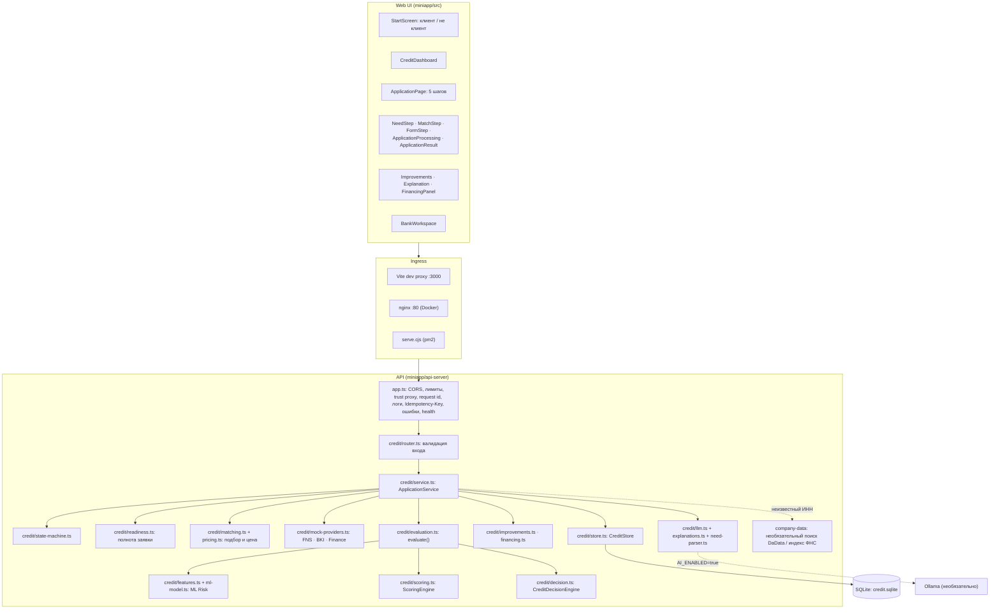
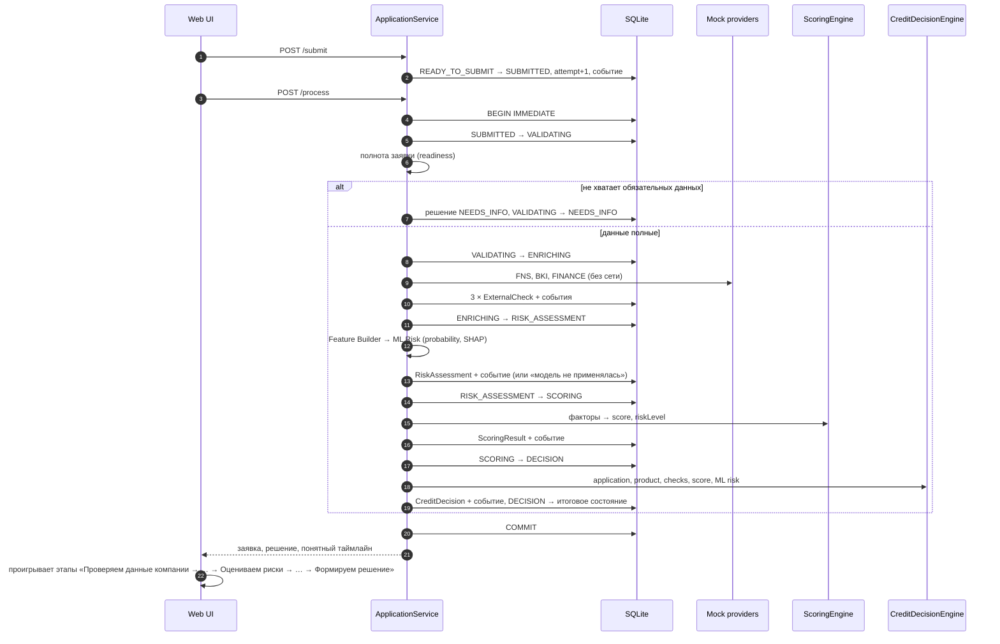
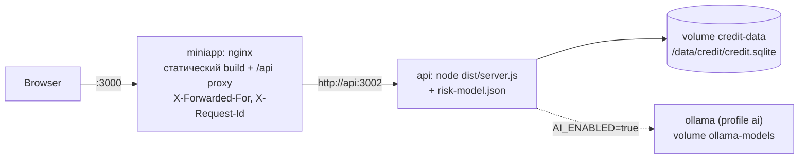

# Архитектура

Монолит из двух процессов: web-клиент (React/Vite, Alfa Design System) и API (Express/TypeScript) с SQLite.
ML-модель риска обучается офлайн в `ml/` (Python) и исполняется внутри API (TypeScript), поэтому Python в рантайме не
нужен. LLM — необязательный внешний процесс (Ollama). Очереди и брокеры не нужны: обработка заявки занимает
миллисекунды и выполняется синхронно в одной транзакции.

## Компоненты

| Модуль | Ответственность |
|---|---|
| `credit/types.ts` | Сущности домена: Company, CreditProduct, CreditApplication, ApplicationDocument, ExternalCheck, ScoringResult, CreditDecision, ApplicationEvent |
| `credit/state-machine.ts` | Таблица допустимых переходов, `assertTransition`, поиск пути |
| `credit/store.ts` | SQLite-репозиторий, схема, сидирование синтетических данных, транзакции, оптимистичная блокировка |
| `credit/service.ts` | Жизненный цикл заявки: создание, изменение, документы, отправка, обработка, принятие, подписание; представления для клиента и банка |
| `credit/readiness.ts` | Полнота заявки — общее правило для READY_TO_SUBMIT, этапа проверки и фактора скоринга |
| `credit/matching.ts` | Подбор продуктов с объяснением по каждому условию |
| `credit/mock-providers.ts` | Локальные FNSMockProvider, BKIMockProvider, FinancialDataMockProvider |
| `credit/pricing.ts` | Демо-цена: ключевая ставка + маржа продукта + надбавка за риск (LOW 0, MEDIUM 2, HIGH 4 п.п.) |
| `credit/industry.ts` | ОКВЭД → отраслевая группа (общая с генератором датасета) |
| `credit/evaluation.ts` | Чистый конвейер `readiness → ML risk → scoring → decision`; им же считаются сценарии «что если» |
| `credit/features.ts` | Feature Builder: признаки ML-модели из тех же данных, что и скоринг; `null`, если финансов нет |
| `credit/ml-model.ts` | Исполнение экспортированного LightGBM и точный TreeSHAP, факторы простым языком ([ml-risk-model.md](ml-risk-model.md)) |
| `credit/scoring.ts` | ScoringEngine: 6 факторов, 0–100, уровень риска |
| `credit/decision.ts` | CreditDecisionEngine: NEEDS_INFO / REJECTED / APPROVED / COUNTER_OFFER, расчёт встречного предложения, учёт ML-риска |
| `credit/improvements.ts` | «Как улучшить заявку»: сценарии и рекомендации без сохранения |
| `credit/financing.ts` | Моделируемый кредитный счёт: остаток, следующий платёж, возможности |
| `credit/need-parser.ts`, `llm.ts`, `explanations.ts` | Разбор потребности, LLM-ассистент с проверками, шаблоны объяснений ([llm-architecture.md](llm-architecture.md)) |
| `credit/labels.ts` | Тексты для клиента без внутренних терминов; общие для API и UI |
| `credit/synthetic-data.ts` | Синтетические компании A–F (клиенты и не клиенты), банковские профили, 6 продуктов, ответы «источников» |

Frontend импортирует из API только типы, подписи и чистые модули без ввода-вывода (`labels.ts`, `finance.ts`,
`readiness.ts`, `industry.ts`, `state-machine.ts`, демо-значения из `synthetic-data.ts` для кнопки «Заполнить
демо-данными»); серверный код (SQLite, crypto, модель) в бандл не попадает — это проверяется при сборке.

## Обработка заявки

`POST /api/applications/:id/process` выполняет все этапы в одной транзакции SQLite. Если этап падает, транзакция
откатывается и заявка остаётся в `SUBMITTED`; повторный вызов после решения возвращает сохранённый результат.

## Развёртывание

Оба контейнера имеют healthcheck; frontend стартует после здорового API. nginx перезаписывает `X-Forwarded-For`
адресом клиента, API доверяет только loopback и частной сети compose (`TRUST_PROXY`), поэтому лимит запросов
считается по клиенту, а подделать адрес нельзя. Контейнер `ollama` запускается только с `--profile ai` и сам модели
не скачивает. Синтетические компании и продукты
сидируются при каждом старте API (upsert), заявки сохраняются в volume.

Вне Docker тот же frontend обслуживает `miniapp/scripts/serve.cjs` (pm2 через `ecosystem.config.cjs`), серверный
деплой — `ops/deploy.cjs` (сборка во временной папке, переключение артефактов, проверка и откат). Production-экземпляр
изолирован от соседнего проекта на том же сервере: `/opt/alfa-opora`, временные сборки и lock в
`/opt/alfa-opora-deploy`, PM2 `alfa-opora-frontend` (`127.0.0.1:3100`) и `alfa-opora-api` (`127.0.0.1:3102`), домен
`alfa.business-opora.ru`; идентификаторы — в `ops/production.cjs` ([README](../README.md#production-деплой-pm2)).
