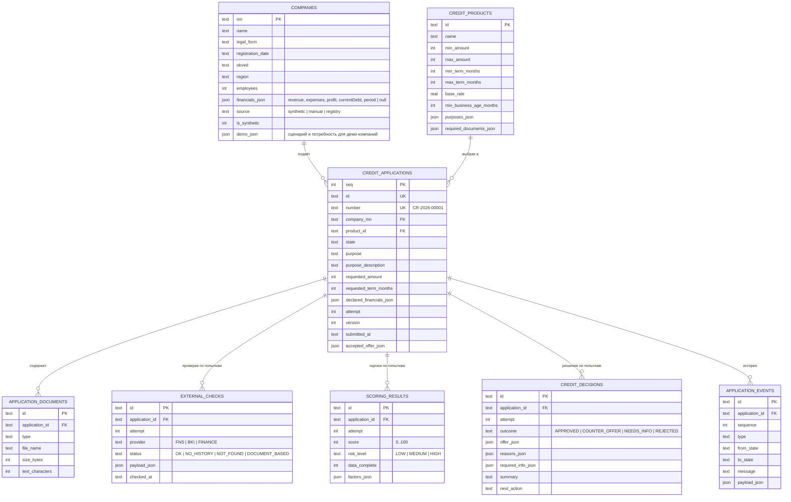

# Модель данных

Каноническое состояние хранится в SQLite (`CREDIT_DB_PATH`). Схема создаётся при старте API (`credit/store.ts`);
синтетические компании и продукты обновляются при каждом старте, заявки и их история сохраняются. Вложенные структуры
(финансы, факторы, причины, payload) хранятся как JSON в текстовых колонках.

## Сущности

| Сущность | Описание | Тип в коде |
|---|---|---|
| Company | Компания-заявитель: реестровые факты и последние известные финансовые показатели. `source`: `synthetic` — демо, `manual` — введена клиентом, `registry` — найдена необязательным поиском DaData/ФНС | `Company` |
| CreditProduct | Синтетический продукт: диапазоны суммы и срока, базовая ставка, минимальный срок работы бизнеса, цели и обязательные документы | `CreditProduct` |
| CreditApplication | Заявка: продукт, цель, сумма, срок, описание, заявленные показатели, состояние, номер попытки, версия, принятое предложение | `CreditApplication` |
| ApplicationDocument | Метаданные документа. Файл не загружается на сервер; хранится число символов, извлечённых в браузере | `ApplicationDocument` |
| ExternalCheck | Ответ mock-провайдера `{ provider, status, payload, checkedAt }` для конкретной попытки | `ExternalCheck` |
| ScoringResult | `score`, `riskLevel`, `factors[] { code, title, impact, maxImpact, effect, explanation }`, признак полноты данных | `ScoringResult` |
| CreditDecision | Итог, условия предложения, причины, запрошенные сведения, краткое резюме и следующий шаг | `CreditDecision` |
| ApplicationEvent | Запись истории с типом, переходом и понятным сообщением | `ApplicationEvent` |

## Целостность

- Внешние ключи включены (`PRAGMA foreign_keys=ON`); проверки, оценки и решения уникальны по `(application_id, attempt)`,
  события — по `(application_id, sequence)`.
- Все изменения заявки идут через `updateApplication` с проверкой `version` (оптимистичная блокировка).
- Обработка и все переходы выполняются в транзакциях `BEGIN IMMEDIATE`; при ошибке частичных записей не остаётся
  (тест `credit/store.test.ts`).
- Синтетические компании нельзя перезаписать данными клиента: при создании заявки для синтетического ИНН
  присланные сведения о компании игнорируются.

## Браузер

`localStorage`/`sessionStorage` хранят только UI-настройки (тема) и незавершённый мастер «Новый кредит» до создания
заявки. Всё, что касается заявки, — на сервере.
