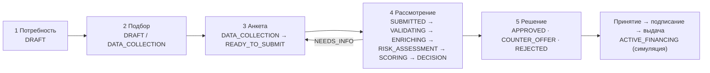

# Пять шагов одной заявки

Все шаги работают с одной `CreditApplication` на сервере; индикатор шагов (Alfa `Steps`) показывает пройденные,
текущий и недоступные шаги. Адрес шага — `#/credit/applications/:id/need|match|form|review|decision` (старые ссылки `#/applications/…` тоже открываются); после перезагрузки
шаг восстанавливается из состояния заявки (`reachedStage` в `ApplicationPage.tsx`). Вернуться можно на любой
пройденный шаг, пока заявка редактируемая.

## 1. Потребность — `NeedStep.tsx`

- Поле «Опишите задачу своими словами» и кнопка «Разобрать описание» → `POST /api/assistant/parse-need`: цель, сумма,
  срок, бизнес-задача. Правила работают всегда, LLM — если включён ([llm-architecture.md](llm-architecture.md)).
- Цель (8 вариантов, Alfa `Tag`), сумма, срок, задача бизнеса.
- Не клиенту — «Ключевые показатели для подбора»: выручка, расходы, кредиты (с подсказками «зачем»), чтобы подбор
  учитывал платёжеспособность уже на шаге 2.
- «Подобрать финансирование» создаёт заявку (`POST /api/applications`) и переводит на шаг 2.

## 2. Подбор — `MatchStep.tsx`, `GET /api/applications/:id/matches`

- Блок «Что мы учли»: ключевая ставка, источник финансов (данные банка / ваши данные / нет), выручка и прибыль, долги,
  кредитная история (предварительная проверка), предварительный риск.
- Карточка каждого из 6 продуктов: ставка с разложением, платёж, переплата, оценка нагрузки, «Почему подходит / не
  подходит» по каждому условию, риски, альтернативы, «Какие данные использованы и ограничения».
- Рекомендация: подходящий → посильный → дешевле → уже по назначению.
- Выбор продукта сохраняет `productId` и переводит на шаг 3. Подбор ничего не записывает в историю проверок.

## 3. Анкета — `FormStep.tsx`

Шесть групп; все поля используются в подборе, скоринге, ML-модели или правилах решения:

| Группа | Поля | Где используется |
|---|---|---|
| Компания | Название, ИНН, регистрация, отрасль, регион, сотрудники (из банка/реестра) | Возраст бизнеса, отрасль и регион — скоринг, ML |
| Финансы | Выручка, расходы → прибыль | Платёжеспособность, скоринг, ML |
| Обязательства | Текущие кредиты, их количество | Долговая нагрузка, сверка с БКИ |
| Кредитная история | Просрочки за 12 мес., максимальная длительность | Сверка с БКИ: расхождение видно в причинах |
| Параметры | Продукт, цель, сумма, срок, описание цели | Условия продукта, решение |
| Документы | Обязательные по продукту + желательные | Полнота, источник финансов для не клиента |

Справа — «Готовность анкеты» по группам, полнота в процентах (учитывается в скоринге), «Заполнить демо-данными»
(никогда не придумывает кредитную историю) и «Отправить на рассмотрение» — доступна только для полной заявки.

## 4. Рассмотрение — `ApplicationProcessing.tsx`

Сервер выполняет всё атомарно (`POST /submit`, `POST /process`), клиент проигрывает записанные этапы: «Проверяем данные
компании», «Получаем сведения» (с результатами проверок), «Оцениваем риски», «Оцениваем заявку», «Формируем решение».
Если данных не хватает — возврат на шаг 3 с перечнем того, что нужно добавить (NEEDS_INFO).

## 5. Решение — `ApplicationResult.tsx`

- «Что произошло», условия (зачёркнуты запрошенные, если предложение встречное), «Почему», «Что дальше».
- «Объяснение» — шаблон или AI-формулировка готового результата.
- «Как улучшить заявку» — для встречного предложения, отказа и среднего риска ([post-credit-support.md](post-credit-support.md#как-улучшить-заявку)).
- Принять → подписать (симуляция) → получить финансирование (симуляция) → кабинет кредита.
- Справа — понятная история заявки.

## Мобильная версия

Все шаги проходят на ширине 360–430 px ([design-system.md](design-system.md#телефон-360430-px)): «‹» в кабинет и статус
вместо хлебных крошек, «Шаг N из 5» с пятью сегментами (полный список — «Все шаги»), формы в одну колонку,
компактная «Готовность анкеты» над формой, главное действие шага закреплено снизу, вторичное свёрнуто в строки-раскрытия,
сценарии улучшения и банковские заявки — карточками. E2E проверяет отсутствие горизонтальной прокрутки и размер
целей нажатия.
