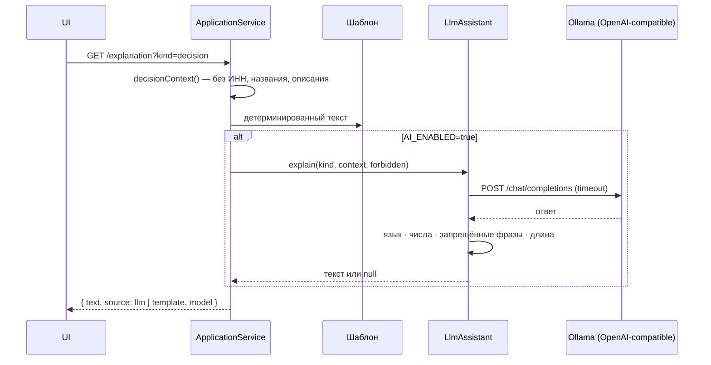

# LLM-ассистент

LLM в «Опоре» — необязательный помощник, который делает тексты человечнее. Он **не принимает решение, не оценивает
риск, не считает суммы и не меняет результат**. Весь кредитный сценарий работает с `AI_ENABLED=false` (значение по
умолчанию): вместо ответа модели используются детерминированные шаблоны.

## Где используется

| Задача | Вход модели | Что проверяется в ответе | Фолбэк |
|---|---|---|---|
| Разбор потребности (`POST /api/assistant/parse-need`) | Текст клиента с замаскированными e-mail, телефонами, ИНН | JSON по схеме; цель из списка; срок 3–60; сумма **равна** найденной правилами; тексты на русском | Парсер на правилах `credit/need-parser.ts` |
| Объяснение решения (`GET /explanation?kind=decision`) | Структурированный результат: исход, суммы, срок, ставка, причины, следующий шаг | Русский язык; все суммы и проценты есть в контексте; нет запрещённых фраз для исхода | Шаблон `templateDecisionText` |
| Объяснение сценариев «Как улучшить заявку» (`kind=improvements`) | Решение + рассчитанные сценарии + рекомендации | То же; нет обещаний («гарантированно», «точно одобрят») | Шаблон `templateImprovementsText` |

Рекомендации и сами сценарии рассчитываются кодом (`credit/improvements.ts`); модель только формулирует пояснение.

При разборе потребности сигналы, которые распознали правила, имеют приоритет: если правила нашли цель («вторую
кофейню» → новая точка), цель, срок и категория берутся из правил, а модель только формулирует бизнес-задачу и
заполняет нераспознанное. Сумму модель изменить не может.

## Поток

Результат кэшируется на заявку, попытку и вид объяснения. Интерфейс подписывает источник: «AI-объяснение · модель …» с пометкой, что решение принимает кредитная логика, или просто «Объяснение». Ошибка объяснения не блокирует
экран: блок просто не показывается.

## Отказоустойчивость

| Ситуация | Поведение |
|---|---|
| `AI_ENABLED` не `true` | Сетевых вызовов нет, шаблон |
| Endpoint недоступен, HTTP-ошибка | Шаблон, `lastError` в `/api/health → ai` |
| Таймаут (`LLM_TIMEOUT_MS`, 1–60 с, по умолчанию 20 с) | `AbortSignal.timeout`, шаблон, `lastError: timeout` |
| Пустой или невалидный ответ, не JSON, не та схема | Шаблон |
| Ответ не на русском (< 80% кириллицы среди букв) | Шаблон |
| Выдуманные числа: сумма или процент, которых нет в контексте | Шаблон |
| Противоречие решению («одобрено» при отказе и т. п.), обещание одобрения | Шаблон |

Все случаи покрыты `credit/llm.test.ts` (поддельный транспорт, без сети).

## Данные и безопасность

- В контекст объяснения не попадают ИНН, название компании и свободное описание цели (`decisionContext`).
- Текст потребности перед отправкой проходит `maskPersonalData`: e-mail, телефоны, 10/12-значные номера.
- По умолчанию endpoint локальный (`http://127.0.0.1:11434/v1`), в Docker — контейнер `ollama` в той же сети.
  Внешний endpoint возможен (`LLM_BASE_URL`, `LLM_API_KEY`), статус показывает `endpoint: remote`.
- Ключи не хранятся в git (`.env` в `.gitignore`); без ключа заголовок `Authorization` не отправляется.
- Ответ модели никогда не записывается в решение, оценку или состояние заявки.

## Выбор модели и рантайма

**Рантайм: Ollama.** Один бинарник или контейнер, OpenAI-совместимый `/v1/chat/completions`, работает на CPU и Apple
Silicon, модели подтягиваются одной командой. llama.cpp server — легче, но требует ручной работы с GGUF; vLLM — для
GPU-кластера и избыточен для демо.

**Модель по умолчанию: `qwen2.5:7b-instruct`.**

| Критерий | Qwen2.5-7B-Instruct |
|---|---|
| Лицензия | Apache-2.0 (open-weight, коммерческое использование разрешено) |
| Класс | 7B (в Ollama — Q4_K_M, ≈4,7 ГБ) |
| Русский язык | Многоязычная модель, русский входит в поддерживаемые языки; уверенно держит JSON-формат |
| Скорость | Ориентир: несколько секунд на ответ до 120 слов на Apple Silicon / современном CPU; таймаут 20 с |

Альтернативы того же класса, допустимые через `LLM_MODEL`: `qwen2.5:14b-instruct` (точнее, медленнее), открытые
модели с хорошим русским (например, семейства Qwen или T-lite/Vikhr) — с проверкой их лицензии.

**Что проверено на стенде.** Интеграция end-to-end (транспорт, валидация, фолбэк, слияние с правилами) прогнана с
локальной Ollama 0.24 и уже установленной `llama2` 7B: разбор потребности принят после слияния с правилами, а
объяснение на английском и с выдуманным «50%» отклонено валидацией и заменено шаблоном. Это подтвердило, что модели
без хорошего русского не подходят, и привело к проверкам языка и процентов. Веса `qwen2.5:7b-instruct` на стенде не
скачивались; качество её русских ответов нужно проверить после `ollama pull`.

## Почему не закрытые API

GigaChat, YandexGPT, OpenAI, Claude и другие проприетарные LLM не являются обязательной зависимостью: демо должно
работать автономно, без ключей и без передачи данных клиента третьим лицам.

## OCR

Распознавание сканов документов — open-source tesseract.js с локальными языковыми данными, прямо в браузере
(`miniapp/src/shared/document-reader.ts`). Yandex OCR и другие внешние OCR-сервисы не используются; на сервер уходят
только метаданные документа.
