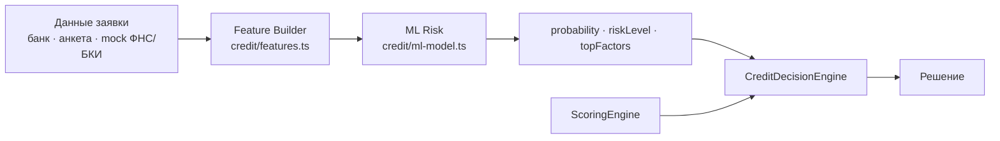

# ML-модель риска

> **Это DEMO-модель. Она не является банковской моделью Альфа-Банка.** Она обучена на сгенерированных данных и
> показывает, как отдельная модель риска встраивается в кредитный конвейер. Её числа не описывают реальный риск.

## Место в конвейере



- **ML не принимает решение.** `CreditDecisionEngine` использует вероятность как один сигнал: при `probability ≥ 0,20`
  заявка считается рискованнее — уровень риска MEDIUM, надбавка к ставке +2 п.п., причина `ML_RISK_CAUTION`.
  Стоп-факторы (просрочка ≥ 60 дней, убыток, недействующая компания, слишком молодой бизнес) и правила
  платёжеспособности работают независимо от модели: низкая вероятность не одобрит то, что отклоняют правила
  (тест `scoring-decision.test.ts`).
- **Модель не угадывает.** Если финансовых данных нет, признаки не строятся, модель не вызывается, а решение
  запрашивает данные (сценарий C).
- **Отключаемость.** `RISK_MODEL_ENABLED=false` — решения только по скорингу и правилам; поток не меняется.
- Оценка сохраняется в таблице `risk_assessments` по попыткам подачи и видна на банковской стороне.

## Целевая переменная

`default12m` — бинарное событие «серьёзные трудности с обслуживанием долга в течение 12 месяцев». Метрики WAPE и
accuracy как основная метрика не используются: первая — для регрессии/прогноза объёмов, вторая неинформативна при
доле положительного класса ~8%.

## Синтетический датасет (`ml/generate_dataset.py`)

60 000 строк, `seed=2026`, повторный запуск даёт побайтно тот же файл. Каждая строка — вымышленный бизнес с запросом:
отрасль, форма, регион, срок работы, сотрудники, выручка, рентабельность, долговая нагрузка, кредиты, просрочки,
сумма, срок, цель, ключевая ставка, платёж и его доля в прибыли.

Целевая переменная не задаётся правилом. Сначала строится **латентная вероятность** из многих факторов:
срок работы, рентабельность, долг/выручка, просрочки и их длительность, просроченная задолженность, платёж/прибыль,
сумма/выручка, отраслевой риск, регион, форма, ключевая ставка, цель; плюс **ненаблюдаемое «качество управления»**
(влияет и на признаки, и на риск, но в датасет не попадает) и **шум**. Затем `default12m` сэмплируется из этой
вероятности. Поэтому идеальная модель недостижима — потолок задаёт сама латентная вероятность (ROC-AUC 0,896).

Коэффициенты генератора — демонстрационные; это не кредитная политика и не статистика банка.

## Признаки (`ml/feature_spec.json`)

13 числовых (срок работы, сотрудники, log₁₀ выручки, рентабельность, долг/выручка, кредиты, просрочки за 12 мес.,
макс. просрочка, просрочка/выручка, сумма/выручка, срок, платёж/прибыль, ключевая ставка) и 4 категориальных
(форма, отрасль, регион, цель) в one-hot. Спецификация общая для Python и TypeScript, поэтому обучение и инференс
кодируют признаки одинаково.

Для LightGBM заданы **ограничения монотонности**: риск не может падать с ростом просрочек, долговой нагрузки,
доли платежа в прибыли, суммы относительно выручки и ставки, и не может расти с ростом рентабельности и срока
работы. Это защищает от «странных» объяснений вне области данных.

## Обучение и выбор модели

Разбиение 70/15/15 со стратификацией. Сравниваются:

- **Logistic Regression** (стандартизация + L2) — сильная интерпретируемая базовая модель;
- **LightGBM** (15 листьев, early stopping по валидации: 176 деревьев).

Правило выбора задано заранее: максимальный PR-AUC на валидации (редкий положительный класс), затем Brier.

## Метрики на тесте (9 000 строк, `ml/reports/metrics.json`)

| | ROC-AUC | PR-AUC | Brier | Log-loss |
|---|---|---|---|---|
| Logistic Regression | 0,874 | 0,482 | 0,0543 | 0,192 |
| **LightGBM (выбрана)** | **0,876** | **0,481** | **0,0542** | **0,191** |
| Потолок генератора | 0,896 | 0,531 | — | — |

Порог 0,20 (порог осторожности в правилах решения), LightGBM: precision 0,36, recall 0,59, F1 0,45, под порог попадает
13% заявок. Матрица ошибок: TN 7545, FP 743, FN 289, TP 423. При F1-оптимальном пороге с валидации (0,21) —
precision 0,38, recall 0,57, F1 0,46.

**Калибровка** (децили, предсказано → наблюдалось): 0,3% → 0,1%, 1,1% → 2,1%, 3,8% → 3,3%, 7,8% → 8,1%,
17,5% → 17,6%, 43,8% → 42,1%. Модель откалибрована без дополнительной калибровки, поэтому вероятность можно
показывать как вероятность.

**Честный вывод сравнения.** Bootstrap-разница LightGBM − LR: ROC-AUC +0,001 (95% ДИ −0,002…+0,004), PR-AUC −0,001
(ДИ −0,012…+0,011) — модели неразличимы. Это ожидаемо: генератор почти аддитивен в логитах. LightGBM выбрана по
заранее заданному правилу и потому, что даёт монотонные ограничения, нелинейные пороги «из коробки» и точные
SHAP-значения деревьев; логистическая регрессия остаётся равноценной альтернативой.

## Объяснимость

`credit/ml-model.ts` считает **точный TreeSHAP** (алгоритм Lundberg et al., 2018) по экспортированным деревьям;
расхождение с `pred_contrib` LightGBM на фикстурах — 4·10⁻¹⁶. Вклады one-hot колонок суммируются в исходный признак
(«отрасль»), берутся 4 крупнейших по модулю (|SHAP| ≥ 0,02), и каждому даётся текст на русском:

```json
{ "probability": 0.0052, "riskLevel": "LOW", "topFactors": [
  { "feature": "paymentToProfit", "impact": "positive", "text": "Платёж около 40% среднемесячной прибыли — нагрузка посильная" },
  { "feature": "profitMargin", "impact": "positive", "text": "Хорошая рентабельность — 18%" },
  { "feature": "latePayments12m", "impact": "positive", "text": "Нет просрочек за последние 12 месяцев" } ] }
```

`impact: negative` — фактор повышает риск. Оценочное прилагательное («высокая», «посильная») показывается, только если
оно согласуется со знаком вклада. Глобально важнее всего (средний |SHAP|): платёж/прибыль, рентабельность, долговая
нагрузка, просрочки, ключевая ставка, длительность просрочки, отрасль, срок работы.

Уровни: LOW < 0,10 ≤ MEDIUM < 0,20 ≤ HIGH.

## Демо-компании

| | Вероятность | Уровень | Главные факторы |
|---|---|---|---|
| A Хлебозавод | 0,5% | LOW | посильный платёж, рентабельность 18%, нет просрочек |
| B Техсервис | 1,3% | LOW | рентабельность 20%; сумма — 50% выручки повышает риск |
| C Агро | — | — | финансов нет → модель не вызывается, NEEDS_INFO |
| D Ремстрой | 99,5% | HIGH | 5 просрочек, платёж 760% прибыли, просрочка 97 дн., долги 79% выручки |
| E Кофейня | 0,6% | LOW | платёж 37% прибыли, рентабельность 18% |
| F Старт | 2,8% | LOW | срок работы 10 мес. и цель «молодой бизнес» повышают риск |

Исходы A–F те же, что без модели: ML добавляет второй взгляд и объяснение, а не меняет логику демо.

## Ограничения

- Данные сгенерированы, метрики показывают качество метода на этих данных, а не реальную предсказательную силу.
- Нет временной валидации, дрейфа, reject inference и мониторинга — в продуктиве они обязательны.
- Признаки «банковских» данных у клиента и заявленных у не клиента имеют разную достоверность; модель этого не различает.
