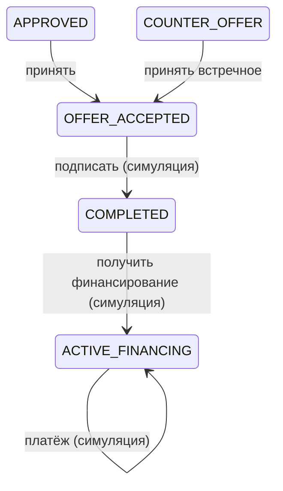

# После решения: улучшение заявки и сопровождение

## Как улучшить заявку

Блок появляется при встречном предложении, отказе или среднем риске (`Improvements.tsx`,
`GET /api/applications/:id/improvements`, `credit/improvements.ts`).

**Расчётные сценарии.** Сумма × 0,9 / 0,8 / 0,7 / 0,6 и сроки «как запрошено», +12 месяцев, максимум продукта, плюс
полная сумма на максимальный срок. Каждый сценарий проходит **тот же конвейер**, что и заявка (`evaluate()`: ML-риск →
скоринг → решение) на проверках текущей попытки и ничего не сохраняет. Для каждого показаны платёж, доля платежа в
прибыли (комфортно / на пределе / выше допустимого), оценка, риск и **ориентировочный результат**. Показываются текущая
заявка и до 5 лучших сценариев.

**Рекомендации** строятся из факторов скоринга, правил и ML: погасить просрочку, снизить долговую нагрузку, уменьшить
сумму или разбить на этапы, увеличить срок, подтвердить прибыльность, заполнить анкету полностью, обратить внимание на
факторы модели риска. Если отказ вызван стоп-фактором (критическая просрочка, убыток, недействующая компания, слишком
молодой бизнес), блок прямо говорит, что изменение суммы и срока этого не исправит.

**Формулировки** — только «Расчётный сценарий», «Ориентировочный результат», «Может улучшить…»; дисклеймер: это не
обещание одобрения, решение принимается после повторной подачи. Обещания проверяются в шаблонах и в ответе LLM.

Пример (B «Демо Техсервис», запрошено 15 000 000 ₽ / 36 мес.): текущая заявка — платёж 538 531 ₽ (108% прибыли),
ориентировочно встречное предложение до 9 900 000 ₽; сценарий 9 000 000 ₽ / 60 мес. — платёж 226 100 ₽ (45%),
ориентировочно «одобрено».

## Выдача и сопровождение (симуляция)

- `POST /issue` создаёт моделируемый кредитный счёт `FinancingAccount` из принятых условий: сумма, срок, ставка,
  платёж, `paidInstallments: 0`, `ACTIVE`. Деньги не перечисляются.
- Кабинет кредита (`FinancingPanel`): сумма, срок, ставка, остаток долга (аннуитетная формула), следующий платёж и
  дата, статус, прогресс платежей, условия договора, история.
- «Смоделировать очередной платёж» — `POST /payments`: событие `PAYMENT_SIMULATED`, после последнего платежа —
  `REPAID`, далее `409 FINANCING_REPAID`. UI и smoke-тест передают `Idempotency-Key`, чтобы повторный клик или ретрай
  сети не учли платёж дважды.

## Следующие возможности

| Код | Когда доступно | Что предлагает |
|---|---|---|
| `LIMIT_INCREASE` | после 6 платежей без просрочек | Увеличение лимита |
| `ADDITIONAL_WORKING_CAPITAL` | сразу (кроме случая, когда выдан оборотный кредит) | Дополнительное оборотное финансирование |
| `REFINANCING` | если у бизнеса есть другие кредиты | Рефинансирование |
| `INVESTMENT` | бизнесу ≥ 24 месяцев | Новый инвестиционный кредит |

Недоступные возможности показываются с условием («Станет доступно после 6 платежей… (сейчас 1)»). «Оформить» ведёт
к новой заявке.

Тесты: `credit/journey.test.ts` (выдача, 12 платежей, `REPAID`, возможности), `contracts.test.ts`, E2E (сценарий A).
