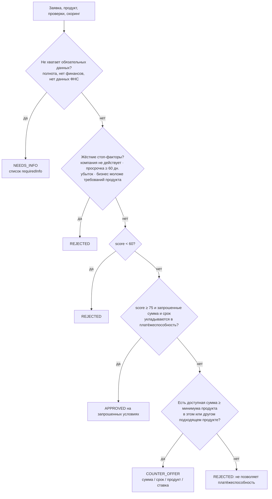

# Скоринг и кредитное решение

> **Демонстрационная логика.** Факторы, веса, пороги, ставки и правила ниже придуманы для MVP и показывают, как
> устроен объяснимый конвейер. Это не модель и не кредитная политика какого-либо банка; на реальные решения они
> не переносятся.

Скоринг и решение — два отдельных шага:

- **ScoringEngine** (`credit/scoring.ts`) превращает факты в оценку 0–100 и уровень риска. Оценка — входная величина,
  а не решение.
- **CreditDecisionEngine** (`credit/decision.ts`) получает заявку, продукт, внешние проверки и оценку и возвращает
  APPROVED, COUNTER_OFFER, NEEDS_INFO или REJECTED с причинами, условиями и следующим шагом.

Обе части детерминированы: одинаковые данные всегда дают одинаковый результат. LLM и ML не используются.

## Источники фактов

| Факт | Откуда |
|---|---|
| Срок работы бизнеса | `registrationDate` из проверки ФНС, иначе из профиля компании |
| Платёжная дисциплина | БКИ: `maxDaysOverdue`, `overdueAmount`, `hasHistory` |
| Выручка, прибыль | Финансовые данные (синтетический источник или заявленные цифры, подтверждённые отчётностью) |
| Долг | Максимум из `currentDebt` финансовых данных и `activeDebt` БКИ |
| Полнота заявки | Доля выполненных пунктов `readiness` (включая желательные) |

## Факторы скоринга (сумма весов — 100)

| Фактор (`code`) | Вес | Правило (берётся первая подходящая полоса) |
|---|---|---|
| Срок работы бизнеса (`businessAge`) | 15 | ≥ 60 мес. — 15; ≥ 36 — 12; ≥ 24 — 9; ≥ 12 — 5; ≥ 6 — 2; меньше или неизвестно — 0 |
| Платёжная дисциплина (`paymentDiscipline`) | 25 | Нет просрочек — 25; просрочка ≤ 5 дн. — 20; ≤ 30 — 12; ≤ 59 — 5; больше — 0; кредитной истории нет — 15 (нейтрально) |
| Долговая нагрузка (`debtLoad`) | 20 | Долг / выручка ≤ 15% — 20; ≤ 30% — 15; ≤ 50% — 9; ≤ 80% — 4; больше — 0 |
| Сумма относительно выручки (`requestedAmountToRevenue`) | 15 | Сумма / выручка ≤ 10% — 15; ≤ 20% — 12; ≤ 35% — 8; ≤ 50% — 4; больше — 0 |
| Прибыльность (`profitability`) | 15 | Прибыль / выручка ≥ 20% — 15; ≥ 12% — 12; ≥ 6% — 8; > 0 — 4; убыток — 0 |
| Полнота заявки (`applicationCompleteness`) | 10 | round(доля выполненных пунктов × 10) |

Без данных о выручке три финансовых фактора получают 0, а `dataComplete = false`.

Каждый фактор возвращается как `{ code, title, impact, maxImpact, effect, explanation }`; `effect = positive`, если
набрано ≥ 70% веса, `negative` — если ≤ 30%, иначе `neutral`. Уровень риска: **≥ 75 — LOW, 60–74 — MEDIUM, < 60 — HIGH**.

## Правила решения

Правила применяются по порядку; срабатывает первое.



### 1. NEEDS_INFO

- Не выполнены обязательные пункты полноты (защита на сервере, если данные изменились).
- Финансовых данных нет в источнике (`FINANCE: NOT_FOUND`): запрашиваются показатели за последний год (если не указаны)
  и бухгалтерская отчётность (если не приложена). Заявленные цифры учитываются только вместе с отчётностью.
- Компании нет в реестре (`FNS: NOT_FOUND`): запрашивается выписка из ЕГРЮЛ/ЕГРИП.

### 2. Жёсткие стоп-факторы → REJECTED

| Код причины | Условие |
|---|---|
| COMPANY_INACTIVE | ФНС: компания не действует |
| CRITICAL_OVERDUE | БКИ: максимальная просрочка ≥ 60 дней |
| NO_PROFIT | Прибыль ≤ 0 |
| BUSINESS_TOO_YOUNG | Срок работы меньше минимума продукта |

### 3. Порог оценки

`score < 60` → REJECTED с причиной LOW_SCORE и отрицательными факторами.

### 4. Платёжеспособность и встречное предложение

- **Платёж:** ежемесячный аннуитетный платёж ≤ 50% среднемесячной прибыли (`profit / 12 × 0.5`).
- **Долговая ёмкость:** новый кредит + текущие долги ≤ 50% годовой выручки.
- **Ставка:** базовая ставка продукта; при MEDIUM-риске +2 п.п.
- **MEDIUM-риск (60–74):** сумма не больше 80% запрошенной — всегда встречное предложение.

Расчёт предложения для продукта:

```
потолок = min(запрошено × (0.8 при MEDIUM), максимум продукта, долговая ёмкость,
              сумма, обслуживаемая платежом за максимальный срок продукта)
сумма   = запрошено, если потолок ≥ запрошено; иначе потолок, округлённый вниз до 100 000 ₽
срок    = наименьший срок от запрошенного до максимума продукта, при котором платёж укладывается в лимит
```

- **APPROVED** — LOW-риск, сумма и срок совпали с запрошенными.
- **COUNTER_OFFER** — изменились сумма, срок, ставка или продукт. Если сумма ниже минимума выбранного продукта,
  перебираются другие продукты с подходящей целью и сроком работы бизнеса; выбирается предложение с наибольшей суммой.
  Причины поясняют изменения: AMOUNT_REDUCED, TERM_CHANGED, PRODUCT_CHANGED, MEDIUM_RISK.
- **REJECTED (NOT_AFFORDABLE)** — ни один продукт не даёт суммы не ниже своего минимума.

## Объяснения клиенту

Причины решения строятся из факторов скоринга (positive → «✓», negative → «⚠») и правил решения. Клиент видит
формулировки вроде «Компания работает 7 лет 7 месяцев», «Просрочек по кредитам нет», «Запрошенная сумма — 50% годовой
выручки» и резюме «Мы готовы предложить 9 900 000 ₽ на 60 месяцев вместо запрошенных 15 000 000 ₽ на 36 месяцев».
Внутренние коды и названия движков показываются только на банковской стороне.

## Демо-сценарии в цифрах

| Компания | businessAge | paymentDiscipline | debtLoad | amount/revenue | profitability | completeness | Оценка | Решение |
|---|---|---|---|---|---|---|---|---|
| A «Демо Хлебозавод» | 15 | 25 | 20 (8%) | 15 (6%) | 12 (17,5%) | 9 | **96, LOW** | APPROVED: 3 000 000 ₽ / 12 мес. / 19,5% |
| B «Демо Техсервис» | 15 | 25 | 20 (10%) | 4 (50%) | 15 (20%) | 9 | **88, LOW** | COUNTER_OFFER: 9 900 000 ₽ / 60 мес. / 17,5% |
| C «Демо Агро», до дополнения | 12 | 25 | 0 | 0 | 0 | 8 | 45, данных нет | NEEDS_INFO |
| C после дополнения | 12 | 25 | 20 (3%) | 12 (11%) | 15 (27%) | 10 | **94, LOW** | APPROVED: 2 000 000 ₽ / 12 мес. |
| D «Демо Ремстрой» | 15 | 0 (97 дн.) | 4 (79%) | 4 (42%) | 4 (3%) | 9 | **36, HIGH** | REJECTED: CRITICAL_OVERDUE |

B: при прибыли 6 000 000 ₽ платёж ограничен 250 000 ₽ в месяц; за 60 месяцев по 17,5% это ≈ 9 950 000 ₽
(округление вниз — 9 900 000 ₽). Долговая ёмкость — 15 000 000 − 3 000 000 = 12 000 000 ₽, она не ограничивает.

Тесты: `credit/scoring-decision.test.ts` (все сценарии, MEDIUM-риск, убыток, смена продукта, детерминированность).
